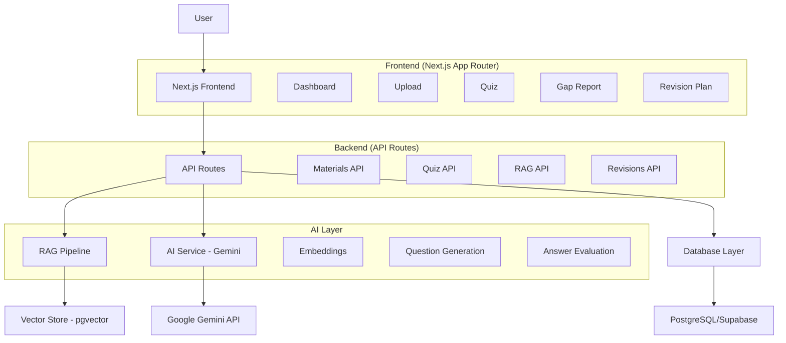

# GapFinder AI - Architecture Overview

## System Architecture

## Components

### Frontend
- **Next.js 16 App Router**: Server and client components
- **Tailwind CSS**: Styling
- **React Components**: Modular UI components
- **Dashboard Layout**: Responsive sidebar navigation

### Backend
- **API Routes**: Next.js API routes for all operations
- **RAG Pipeline**: Retrieval-Augmented Generation for grounded answers
- **Validation**: Zod schemas for API inputs

### AI Services
- **Google Gemini**: LLM for generation and evaluation
- **Embeddings**: Vector embeddings for semantic search

### Data Layer
- **PostgreSQL**: Primary database
- **pgvector**: Vector similarity search
- **Supabase**: Auth, storage, and managed PostgreSQL

## Data Flow

### Material Upload & Ingestion
1. User uploads file (PDF/TXT) or pastes text
2. Text extraction and normalization
3. Chunking with overlap
4. Embedding generation
5. Storage in document_chunks with pgvector

### Quiz Generation
1. Retrieve relevant chunks for topics
2. Generate questions using RAG
3. Validate with Zod
4. Store questions with citations

### Answer Evaluation & Gap Analysis
1. Compare user answer with correct answer
2. Evaluate against source material
3. Update topic mastery scores
4. Classify as Weak/Medium/Strong
5. Generate recommendations

### Revision Plan
1. Analyze weak topics by severity
2. Consider time constraints
3. Prioritize weak topics first
4. Apply spaced repetition
5. Generate daily tasks

## Security
- Row Level Security (RLS) in PostgreSQL
- User data isolation
- Server-side API keys
- Input validation
- Ownership checks on all operations
